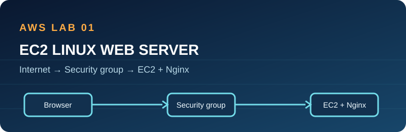

# 01 · EC2 Linux web server

**Status:** Code prepared; AWS deployment and HTTP response not yet verified.

## Architecture

A browser reaches port 80 on a public EC2 instance in the account's default VPC. EC2 user data installs Nginx on Amazon Linux 2023. SSH is closed unless a trusted `/32` CIDR and existing key pair are supplied. IMDSv2 and EBS encryption are enabled.

## Prerequisites and permissions

Terraform >= 1.6, AWS CLI configured with short-lived credentials, a region with a default VPC, and permission to describe AMIs/VPCs/subnets and manage only this lab's EC2 instance, security group, and tags. For least privilege, use a dedicated sandbox account with a permission boundary or administrator-reviewed policy constrained by project tags and region. Terraform state is local.

## Deploy and verify

1. Review `main.tf` and `user-data.sh`; check current EC2, EBS, and public IPv4 prices. Create a small AWS Budget.
2. Run `terraform init`, `terraform fmt -check`, `terraform validate`, and `terraform plan -out=lab.tfplan`.
3. Inspect the plan for one instance, one security group, and the intended region; then run `terraform apply lab.tfplan`.
4. Wait for EC2 status checks and user data to complete. Run `curl -I "$(terraform output -raw url)"`; expect an HTTP response from Nginx. Open the URL in a browser.
5. Verify inbound rules expose only TCP/80 and optional TCP/22 from your exact `/32`; inspect root-volume encryption and metadata options in EC2.

## Troubleshooting

If HTTP times out, check public IP, inbound TCP/80, default VPC subnet route, and instance status. If it responds with an error, review `/var/log/cloud-init-output.log` and `sudo systemctl status nginx` using an authorized console or SSH path. User data runs only on first boot by default.

## Security and cost

HTTP is intentionally unencrypted for a short learning lab; do not put private data on it. Production would use HTTPS, a domain, and stricter outbound rules. A public IPv4 address, EC2 compute, 8 GiB gp3 EBS, and transfer can cost money. Stop or destroy promptly; stopped instances still retain billable EBS and potentially public IP charges.

## Cleanup

Run `terraform destroy` in this directory, confirm the instance and security group are gone, and check for leftover volumes or public IPs. Remove any manually created key pair only if it belongs solely to this lab. Check Billing after cleanup.

## Interview explanation

“I used Terraform to define an Amazon Linux EC2 web server. User data installs Nginx, the security group allows HTTP, and SSH stays closed by default. I can explain the path from browser to subnet to instance, then show how I would verify and clean up the lab.”

## Learning walkthrough

Trace the request: public IP → subnet route through the internet gateway → security group TCP/80 → Nginx. Change the web page, replace the instance, and observe how user data runs at launch. Explain why a security group is stateful, why IMDSv2 matters, and why local state must stay private.
