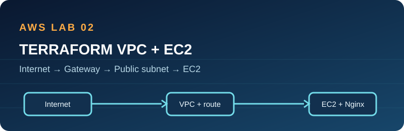

# 02 · Terraform VPC and EC2

**Status:** Code prepared; AWS deployment unverified.

## Architecture and learning goal

Terraform builds a `10.42.0.0/16` VPC, one `10.42.1.0/24` public subnet, an internet gateway, a default route, a security group allowing HTTP, and an Amazon Linux EC2 instance running Nginx. One subnet keeps the lab understandable; it is not highly available.

## Prerequisites and permissions

Terraform >= 1.6; AWS CLI with short-lived sandbox credentials; EC2 permissions to describe images/zones and create, tag, describe, and delete this lab's VPC, subnet, route table, route, internet gateway, security group, instance, and related network interfaces. Scope access to the selected region and project tags where AWS supports it. Have an AWS Budget and check regional pricing first.

## Deploy and verify

1. Read `main.tf` and the shared `../01-ec2-linux-web-server/user-data.sh`.
2. Run `terraform init`, `terraform fmt -check`, `terraform validate`, and `terraform plan -out=lab.tfplan`.
3. Review the plan, then run `terraform apply lab.tfplan`.
4. Inspect the VPC CIDR, subnet CIDR, route `0.0.0.0/0` to the internet gateway, instance public IP, and HTTP-only inbound security group.
5. Run `curl -I "$(terraform output -raw url)"` after user data completes.

## Troubleshooting

For an HTTP timeout, inspect the public IP, security group port 80, route table association, internet gateway attachment, and EC2 status checks. For an Nginx error, inspect cloud-init output and service status. A subnet is public only when its route and instance addressing both allow internet reachability.

## Security and cost

SSH is closed; IMDSv2 and encrypted gp3 root storage are enabled. HTTP is for a disposable demo without sensitive content. This design intentionally has no NAT gateway. EC2, EBS, public IPv4, and transfer may be charged. Review the plan and destroy after the exercise.

## Cleanup

Run `terraform destroy` from this directory. Confirm Terraform reports no resources and the VPC, instance, security group, gateway, routes, and volume are gone. Check Billing later for delayed usage entries.

## Interview explanation

“I defined the network path in Terraform: VPC, public subnet, internet gateway, route table, security group, and EC2. I can identify which component provides addressing, routing, and filtering, and demonstrate how I would test a failed HTTP request.”

## Learning walkthrough

Draw the CIDR ranges; explain why `/24` fits inside `/16`. Follow packets from internet gateway to route table to subnet to security group. Remove the route in a disposable lab, observe the failure, then restore it. Compare this with the default-VPC setup in project 01.
