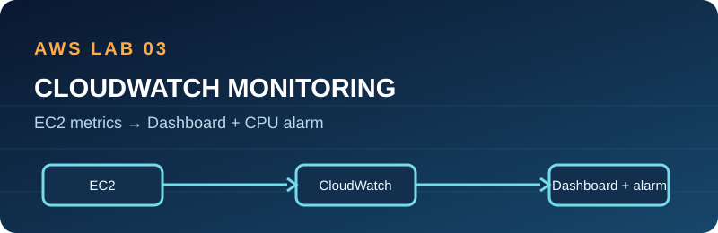

# 03 · CloudWatch monitoring and troubleshooting

**Status:** Code and exercise prepared; AWS alarm, dashboard, and fault simulation unverified.

## Architecture

An existing EC2 instance publishes built-in CPU and status-check metrics to CloudWatch. Terraform creates a two-chart dashboard and a high-CPU alarm. Alarm actions are disabled, so it sends no notification. The exercise uses a temporary HTTP security-group rule change to practise isolating a network fault.

## Prerequisites and permissions

Deploy project 01 or 02 first and obtain its instance ID. Use Terraform >= 1.6 and short-lived AWS credentials with CloudWatch dashboard/alarm create, describe, and delete permissions, plus read-only EC2 access. The optional fault exercise requires narrowly scoped permission to modify that lab security group's TCP/80 rule; restore it immediately.

## Deploy and verify

1. Check CloudWatch pricing and set a Budget. Copy `terraform.tfvars.example` to `terraform.tfvars`; replace the instance ID and choose its region.
2. Run `terraform init`, `terraform fmt -check`, `terraform validate`, and `terraform plan -out=lab.tfplan`; inspect the dashboard and alarm names.
3. Run `terraform apply lab.tfplan`. Open the dashboard in CloudWatch and verify it shows the chosen instance's CPU and status-check metrics.
4. Confirm the alarm is configured at >70% average CPU across two five-minute periods with actions disabled. `INSUFFICIENT_DATA` is possible until enough samples arrive.
5. Follow [troubleshooting.md](troubleshooting.md), record your own evidence, and restore HTTP access.

## Troubleshooting

If charts are empty, confirm region, instance ID, time range, and whether the instance has been running long enough. Check CloudWatch alarm history to explain state changes. A CPU alarm does not diagnose an HTTP failure by itself; correlate metrics with EC2 state, routes, security group rules, and application logs.

## Security and cost

The dashboard and alarm may incur CloudWatch charges; EC2 and its storage continue to cost money. No SNS topic, email endpoint, or external action is created. Do not use stress tools against production systems. Keep troubleshooting in your own disposable lab.

## Cleanup

Run `terraform destroy` here first. Verify the dashboard and alarm are deleted. Then destroy the EC2 lab from project 01 or 02 and check Billing. Restore any manual security group change before leaving the exercise, even if Terraform destroy is delayed.

## Interview explanation

“I configured a CloudWatch dashboard and CPU alarm for an EC2 lab, then used a controlled HTTP outage exercise to separate network reachability from instance health. I would check metrics, EC2 status, routing, security groups, and Nginx logs in that order.”

## Learning walkthrough

Learn the difference between a metric, dashboard, and alarm. Explain the two five-minute evaluation periods and missing data behavior. Run the guided exercise, write down your own observations, and practise explaining why a healthy CPU graph does not guarantee a reachable website.
