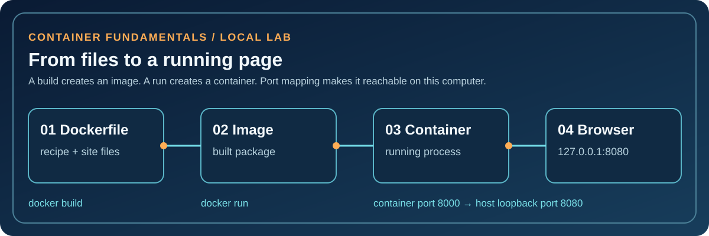
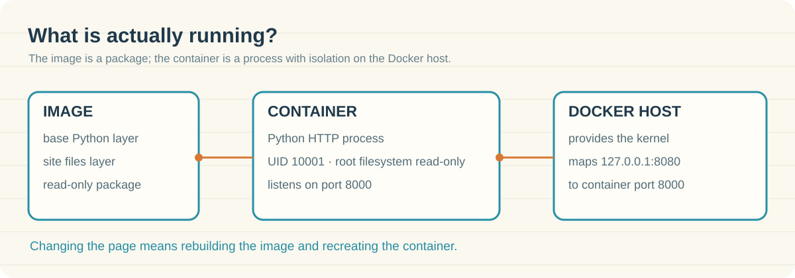

# 04 · Docker container fundamentals

**Status:** Built and verified locally on 2026-10-11: the page responded at `127.0.0.1:8080`, the container reported `healthy`, and inspection showed a read-only root filesystem and user `10001:10001`. The temporary container and project image were removed afterward. This project does not deploy to AWS.

<picture>
  <source media="(max-width: 600px)" srcset="assets/docker-flow-mobile.svg">
  
</picture>



## Docker in one minute

- A **Dockerfile** is the recipe. It names a base image, copies the site, selects a non-root user, and says what process to start.
- An **image** is the built, read-only package. You can create many containers from one image.
- A **container** is one running instance of that image: here, a Python HTTP server process with its own filesystem and network namespace. It shares the Docker host kernel; it is not a full virtual machine. On Docker Desktop, that Docker host is a Linux VM.
- A **port mapping** connects `127.0.0.1:8080` on the host to port `8000` in the container. `EXPOSE 8000` documents the intended port; the `-p` flag is what publishes it.

Think **recipe → packaged meal → served plate**. The recipe does not serve food by itself; the built image does not answer requests until a container is running. The analogy helps remember the order, while the commands below show the real objects.

## What this project contains

| File | Job |
| --- | --- |
| [`Dockerfile`](Dockerfile) | Builds a small static-site image from Python Alpine; runs as numeric user `10001` and includes a localhost health check. |
| [`site/index.html`](site/index.html) | The page copied into the image. |
| [`.dockerignore`](.dockerignore) | Excludes unnecessary local files and common secret file types from the build context. |
| [`assets/docker-flow.svg`](assets/docker-flow.svg) | Animated architecture explanation; all labels remain visible if animation is disabled. |

## Prerequisites

Docker Engine or Docker Desktop with permission to run containers, free local port `8080`, and internet access for the base image on first build. Run this on your own computer. No AWS account or paid cloud resource is needed.

## Build, run, verify

From this directory:

```bash
docker build -t asrar-docker-lab:local .
docker image inspect asrar-docker-lab:local --format '{{.Config.User}}'
docker run -d --name asrar-docker-lab \
  --read-only --cap-drop=ALL --security-opt=no-new-privileges \
  --pids-limit=64 --memory=128m \
  -p 127.0.0.1:8080:8000 asrar-docker-lab:local
docker ps --filter name=asrar-docker-lab
curl -fsS http://127.0.0.1:8080/
docker inspect asrar-docker-lab --format '{{.State.Health.Status}}'
```

Expect the image user to be `10001:10001`, the page heading “Inside the container,” and a `healthy` health status after the first check. Open `http://127.0.0.1:8080` in a browser. If the health status is `starting`, wait about 30 seconds and inspect again. Do not copy expected output into the README as proof; record your own result when you run it.

## Learn by changing one thing

Edit `site/index.html`, rebuild with the same `docker build` command, then remove and recreate the container. The running container will not magically change when the source file changes: the image must be rebuilt and a new container started. Compare `docker image ls`, `docker ps`, and `docker ps -a` to distinguish images from running and stopped containers.

## A safe troubleshooting drill

1. Run `docker logs asrar-docker-lab` and `docker inspect ... --format '{{.State.Health.Status}}'` before changing anything.
2. Stop the container with `docker stop asrar-docker-lab`; retry `curl -v http://127.0.0.1:8080/` and note the connection failure.
3. Run `docker start asrar-docker-lab`; verify the page again.
4. If the page still fails, check the port mapping with `docker port asrar-docker-lab`, then logs and health status. If port 8080 is busy, choose another host port such as `127.0.0.1:8081:8000` when recreating the container.

## Security and cost

The container uses a non-root UID, read-only root filesystem, no added Linux capabilities, `no-new-privileges`, and a loopback-only host port. Keep secrets out of the Dockerfile, page, build context, and image history. The Python standard-library server is useful for a disposable local lab; it is not a production web server. Local CPU, memory, disk, and network use still matter, but this lab itself creates no AWS charge. For production, pin the base image by digest, scan it, use a maintained server, and review the deployment environment.

## Cleanup

```bash
docker stop asrar-docker-lab
docker rm asrar-docker-lab
docker image rm asrar-docker-lab:local
```

The base Python image may remain cached; remove it only if you no longer need it. Check `docker ps -a` and `docker image ls` to see what remains.

## Interview explanation

“I can explain the difference between a Dockerfile, image, and container. In this lab, the Dockerfile packages a static page, the image holds the files and startup command, and a container runs the HTTP process. I publish it only on localhost, run it as a non-root user, inspect health and logs, then remove it cleanly.”

## Questions I should be able to answer

1. What changes when I edit the page: source file, image, or running container?
2. Why does `EXPOSE 8000` not make the page reachable from the host by itself?
3. Why bind the host port to `127.0.0.1`?
4. How would I tell a stopped container from a healthy one?
5. What is one important difference between a container and an EC2 instance?

The [Docker overview](https://docs.docker.com/get-started/docker-overview/), [Dockerfile guide](https://docs.docker.com/get-started/docker-concepts/building-images/writing-a-dockerfile/), and [port publishing guide](https://docs.docker.com/engine/network/port-publishing/) are the references for these concepts.
